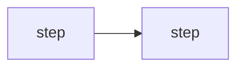

# Workflow spec: <name>

Copy this file for every workflow: fixed steps that run in order, with AI
only inside a step where reading or writing needs it. Same seven sections
as the agent template, so security is decided at each step.

> **Workflow or agent?** If the order of steps is known in advance, it is a
> workflow. A workflow is cheaper, testable step by step, and can be re-run.

---

## 1. Purpose and boundaries *(Developer)*

| | |
|---|---|
| **Job, in one sentence** | |
| **Triggered by** | |
| **Input** | |
| **Output** | |
| **Done when** | |
| **Out of scope** | |

## 2. Steps

| # | Step | Code or AI | Input → output | On failure | Safe to re-run? |
|---|---|---|---|---|---|
| 1 | | | | retry · skip and flag · stop and tell the owner | |

Diagram (optional, Mermaid):

## 3. AI inside steps *(System prompt + paved roads)*

For each step that uses AI:

| Step | Prompt (path) | Allowed output (schema) | Refusal / unsure behaviour | Model | Why |
|---|---|---|---|---|---|
| | | | flag for a person, never guess | | |

Rules: AI output is checked against its schema by code; anything it reads
from users or files is data, never instructions.

## 4. Threats and design review *(AI security review)*

| Threat | Where in the steps | Defence | Tested by |
|---|---|---|---|
| Untrusted input (files, audio, web) | | | |
| Data poisoning | | | |
| Leakage between businesses | | | |
| Personal details stored | | | |
| Cost or loop runaway | | | |

## 5. Tests that must pass *(Policy gates)*

| Gate | Cases | Bar |
|---|---|---|
| Each step on its own (unit) | | all pass |
| End to end on a known input | | |
| Attack inputs | | |
| Isolation and personal details | | zero leaks |

## 6. Release *(Deployment)*

local → staging → production; only versions whose gates passed.

## 7. Live checks *(Runtime verification)*

| | |
|---|---|
| **Status shown to the person** | |
| **Audit log** | |
| **Alerts** | |
| **Debug view** | one event per step (started · done · flagged, with time) for the live panel |
| **Reset / re-run** | what can be re-run, by whom |
