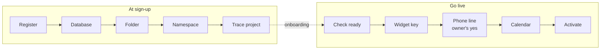

# Workflow spec: Cells and go-live

From `docs/templates/WORKFLOW.md`. Status: **draft for review**.

Each business runs in its own **cell**: its own database file, file folder,
Pinecone namespace, secrets, trace project and phone number. Code serving one
business opens only that business's cell, so it has no way to reach another's
data (D16). This workflow creates a cell when a business signs up and makes
it live at the end of onboarding.

## 1. Purpose and boundaries *(Developer)*

| | |
|---|---|
| **Job, in one sentence** | Creates a business's isolated cell at sign-up, activates its widget, phone line and calendar at go-live, and empties or removes it on reset or delete. |
| **Triggered by** | Part A: the owner submitting business basics (onboarding step 1). Part B: "Go live" (onboarding's final step). Part C: "Reset onboarding". Part D: "Delete business" |
| **Input** | Business basics; the owner's yes for anything that costs money |
| **Output** | Part A: a *draft* cell. Part B: a *live* cell with a widget key, and a phone line if chosen |
| **Done when** | The cell's status is *live*, and the registry routes its widget key and phone number to it |
| **Out of scope** | Reading documents (onboarding workflow); a separate running copy per business (level 3, later) |

### What a cell holds

| Part | Where | Created in |
|---|---|---|
| Database | `data/businesses/<id>/business.db` (SQLite) | A |
| Files | `data/businesses/<id>/files/` | A |
| Search | Pinecone namespace `<id>` | A |
| Traces | LangSmith project `smartdesk-<id>` | A |
| Secrets | calendar credentials, phone and voice-agent ids, kept per business in the secret store, never in the cell's files | B |
| Widget key | registry: key → business, with the allowed website domains | B |
| Phone line | Twilio number and voice agent; registry: number → business | B |

### What stays shared (the control plane)

The landing page, sign-up and onboarding screens, and the **registry**: a
small database that maps widget keys and phone numbers to a business id, and
records each cell's status. The registry holds no business content.

## 2. Steps

**Part A: create the cell (onboarding step 1)**

| # | Step | Code or AI | Input → output | On failure | Safe to re-run? |
|---|---|---|---|---|---|
| A1 | Register | code | basics → business id; registry row, status *draft* | stop; nothing created | yes |
| A2 | Database | code | empty schema in the cell's database file | undo A1 | yes |
| A3 | Folder | code | the cell's file folder | undo A1–A2 | yes |
| A4 | Namespace | code | Pinecone namespace `<id>` | undo A1–A3 | yes |
| A5 | Trace project | code | LangSmith project | undo A1–A4 | yes |

**Part B: go live (onboarding's final step)**

| # | Step | Code or AI | Input → output | On failure | Safe to re-run? |
|---|---|---|---|---|---|
| B1 | Check ready | code | at least one document processed and its safety check passed | stop with the reason | yes |
| B2 | Widget key | code | new key, tied to the business's website domains; registry row | undo | yes (reuses the key) |
| B3 | Phone line (optional) | code, **after the owner's yes to the monthly cost**; demo build: the set number is assigned, nothing bought (D32) | number bought (or an existing one attached) → voice agent → registry row | undo B2–B3; release only a number bought in this run | yes (never buys twice) |
| B4 | Calendar | code | each staff member's Google Calendar (D18) shared with SmartDesk and readable; free times found for one test day | undo B2–B3; tell the owner which calendar is missing | yes |
| B5 | Activate | code | status *live*; audit entry | undo B2–B4 | yes |

Each part is **all or nothing**: on a failure, what that run created is
undone and the cell keeps its earlier status, with a clear message.

**Part C: reset onboarding** (empties the cell; keeps basics and connections)

| # | Step | Output |
|---|---|---|
| C1 | Pause the assistant | status *resetting*; widget and phone say "temporarily unavailable" |
| C2 | Stop processing | documents still being read are cancelled |
| C3 | Remove search entries | the cell's Pinecone namespace emptied |
| C4 | Remove documents and sections | documents and sections tables emptied in the cell's database; business basics and customer records (waitlist, offers, hand-offs, feedback, unanswered questions) kept, since they are about customers, not documents |
| C5 | Remove uploaded files | the cell's file folder emptied |
| C6 | Check the cell is empty | zero documents, sections, services, search entries and files; otherwise stop and show what is left |
| C7 | Ready to onboard again | status *draft*; the owner returns to the upload step |

**Part D: delete business** (removes the cell)

| # | Step | Output |
|---|---|---|
| D1 | Pause the assistant | status *deleting* |
| D2 | Disconnect the widget key | key removed from the registry; the snippet stops working |
| D3 | Detach the phone number | number unlinked and kept on the account (not released, unless the owner asks) |
| D4 | Remove calendar access | the business's calendar credentials deleted |
| D5 | Remove search | the cell's Pinecone namespace deleted |
| D6 | Remove traces | the cell's LangSmith project deleted |
| D7 | Remove database and files | the cell's folder deleted |
| D8 | Remove from the registry | the business's registry row deleted |
| D9 | Check nothing is left | no folder, namespace, project, key or number points to the business |

Rules for C and D:

- Confirmed by **typing the business name**; owner only; development only
  unless a setting allows it; logged with who and when.
- **Pause first**, so customers never reach a half-emptied assistant.
- Removing cannot be undone, so it can always be **finished**: on a failure
  the cell stays *resetting* or *deleting*, and **Retry** continues from the
  failed step. Nothing partial is restored.
- The owner sees each step's progress, as in setup.
- Only the cell being reset or deleted is touched; a test proves the others
  are unchanged.

### How a request finds its cell

1. A widget request carries its key; a call arrives on a number.
2. The registry maps it to one business id, and checks the cell is *live*
   and, for the widget, that the page's domain is allowed.
3. The app opens **only that cell**: its database, namespace, folder,
   secrets and trace project. Conversation memory and caches are keyed by
   the business id.
4. Owner routes take the business id from the owner's sign-in, never from
   the request.

## 3. AI inside steps *(System prompt + paved roads)*

None. Provisioning is code only; no AI can create, change or delete a cell,
or spend money.

## 4. Threats and design review *(AI security review)*

| Threat | Where | Defence | Tested by |
|---|---|---|---|
| One business reaching another's data | every request | the app opens only the resolved cell; no shared business tables | cross-business tests |
| Forged widget key or wrong domain | resolver | key → one business; domain allow-list | forged-key test |
| Owner of A opening B's console | owner routes | business id from the sign-in only | access test |
| Leak through memory, caches, traces | runtime | keyed by business id; one trace project per business | leak tests |
| Half-provisioned business | A, B | all or nothing; undo on failure | failure-injection tests |
| Buying numbers twice, or by mistake | B3 | owner's yes; idempotent; code only | retry test |
| Noisy neighbour | runtime | per-business rate limits and budgets | load test (later) |

## 5. Tests that must pass *(Policy gates)*

| Gate | Cases | Bar |
|---|---|---|
| Cross-business isolation | business B's widget, phone, owner session and tools aimed at A's data, conversations, traces | **zero** access |
| Provisioning | create, go live, retry, failure at each step | correct status; nothing left half-done |
| Reset and delete | reset empties one cell; delete removes one cell | other cells unchanged |

These run in the pre-push hook (`docs/checklists/PRE-PUSH.md`).

## 6. Release *(Deployment)*

local → staging → production. Later, a cell can move to its own running copy
(level 3) by deploying the same code with only that cell; no code change.

## 7. Live checks *(Runtime verification)*

| | |
|---|---|
| **Status shown to the owner** | draft or live; what go-live created; anything that failed and why |
| **Audit log** | every cell created, activated, reset or deleted; every number bought or released: who and when |
| **Alerts** | a go-live failing; a request whose key or number maps to no live cell |
| **Debug view** | each provisioning step started · done · undone, with time |
| **Reset / re-run** | parts C and D, with progress shown step by step; Retry finishes a failed reset or delete |
