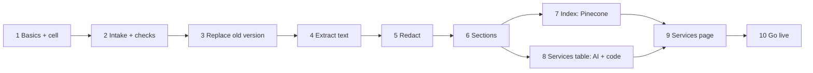

# Workflow spec: Onboarding (v1)

From `docs/templates/WORKFLOW.md`. Status: **draft for review**.

## 1. Purpose and boundaries *(Developer)*

| | |
|---|---|
| **Job, in one sentence** | Turns a business's basics and documents into searchable sections and a services table its assistant can book from. |
| **Triggered by** | The owner submitting basics, then each document finishing its upload (documents are processed independently) |
| **Input** | Business basics (form); documents with the owner's authorization |
| **Output** | Sections in the business's Pinecone namespace; services table in the business's database; a live cell with widget code |
| **Done when** | Go-live succeeds (`docs/workflows/go-live.md`, part B) |
| **Out of scope (v1)** | Call recordings; a scan for odd values, gaps and conflicts; an Onboarding agent; phone-line setup (see the plan's roadmap) |

### Documents accepted

| Kind | Types | Limit |
|---|---|---|
| Document | PDF, DOCX, MD, TXT, CSV | 50 MB · 500 pages per file |
| Image | JPG, PNG | 10 MB per file |

Up to 30 files per upload. Large files upload in chunks and resume after a
dropped connection. The type is checked from the file's contents, not its name.

### Readers (D14)

| Format | Read with | Notes |
|---|---|---|
| PDF | pdfplumber | text per page; tables kept |
| PDF page with no text (scanned) | Claude, reading the page image | |
| DOCX | python-docx | |
| MD, TXT, CSV | Python standard library | |
| JPG, PNG | Claude, reading the image | menus and price boards are often photos |
| Real file type | filetype (the file's first bytes) | a renamed executable is rejected |

Not used: PyMuPDF (AGPL licence, unsuitable for a hosted service); LangChain
loaders (thin wrappers that lose per-page tables). Docling is benchmarked
against pdfplumber (section 5); the better one is kept.

Readers run in a separate process with time and memory limits: a malicious
file can crash only its own job, never the server.

### Where data lives

Everything below is inside the business's own **cell** (D16), created in
step 1; nothing from onboarding is stored in shared space.

| What | Where |
|---|---|
| Business basics | cell database `business.db`, table `business` |
| Original documents | `data/businesses/<id>/files/<document-id>` |
| Document records | cell database, `documents` (name, fingerprint, authorized by, status) |
| Sections (redacted text, document, page) | cell database, `sections`; embedded into Pinecone namespace `<id>`, each entry tagged with its document id |
| Services table | cell database, `services` (service, options with duration and price, staff, quote per value, edited by owner) |

## 2. Steps

| # | Step | Code or AI | Input → output | On failure | Safe to re-run? |
|---|---|---|---|---|---|
| 1 | Basics and cell | code | form → the business's cell, status *draft* (go-live part A) | form shows the error; nothing half-created | yes |
| 2 | Intake and checks | code | chunks → original on disk + `documents` row; real type, size, pages, duplicate fingerprint | reject the file with the reason | yes |
| 3 | Replace | code | same document name uploaded before → its old sections, index entries and services removed | stop; nothing half-replaced | yes |
| 4 | Extract text | code; Claude for images and scanned pages | document → text per page, tables kept | flag the file as unreadable | yes |
| 5 | Redact | code + small AI | text → personal details replaced | stop: nothing unredacted is stored | yes |
| 6 | Sections | code | text → sections by heading, each with document and page | one section per page | yes |
| 7 | Index | code | sections → embeddings in this business's namespace | retry; earlier sections stay searchable | yes |
| 8 | Services table | **AI** + code | sections → services (strict schema) → normalised and validated by code | section skipped and listed on the services page | yes |
| 9 | Services page | code | services table, editable by the owner | — | — |
| 10 | Go live | code | widget key, phone line (owner's yes), calendar → cell *live* (go-live part B) | all undone; cell stays *draft* with the reason | yes |

### Services table rules (code, after the AI)

- **Schema**: Pydantic model: service name, category, options (duration in
  minutes, price), staff; each value with the exact quote it came from.
- **Normalise**: "1 hr" → 60; "$130" → 130.00; "60 / 90 minutes … $130 / $180"
  → two options of one service.
- **Validate**: every quote must appear word for word in the section's text,
  or the value is dropped; durations and prices must be positive and sensible.
- **Abstain**: a value the document does not state stays empty. A service
  without a price is shown as "price missing" and is not bookable.
- **Owner edits** on the services page are saved with "edited by owner" and are
  kept until that document is uploaded again.

### Timing and progress

Steps 2–8 run in the background per document; the owner can leave and come
back. Each document shows its own progress. Rough expectations, to be
replaced by measurements in M4–M5: a few seconds for a short document;
minutes for a 300-page PDF (the services reader runs on sections in parallel).

## 3. AI inside steps *(System prompt + paved roads)*

| Step | Prompt (path) | Allowed output (schema) | Unsure behaviour | Model | Why |
|---|---|---|---|---|---|
| 4 Images, scans | `onboarding/vision.py` | plain text of the page | mark unreadable parts | today's model (D7) | menus and scans have no text layer |
| 5 Redact | `onboarding/redact.py` | text with placeholders | hide when unsure | small model | pattern rules miss names |
| 8 Services | `onboarding/services.py` | `ServicesTable` (strict tool schema) | leave the field empty; never infer | today's model (D7) | understands messy price lists |

The services prompt carries a **terms list for the business type**
(`onboarding/glossaries/<type>.md`, e.g. "60 / 90 min … $130 / $180" means two
options; add-ons are sold only with another service), chosen at run time. Each
call gets one section and its heading, not the whole document.

Document text is data, never instructions, in every prompt.

## 4. Threats and design review *(AI security review)*

| Threat | Where | Defence | Tested by |
|---|---|---|---|
| Malicious file | steps 2, 4 | real type check; limits; readers in a limited separate process | upload tests |
| Poisoned document | steps 7, 8 | text is data to every model; booking prices come only from the validated services table | poisoned-document test |
| Invented prices | step 8 | exact-quote check by code; empty when not stated | eval: zero invented |
| Leakage between businesses | all | every row, file path and namespace bound to the business id | isolation test |
| Personal details stored | steps 4–6 | redact before storing sections | seeded-details test |
| Stale data after re-upload | step 3 | old sections, entries and services removed first | re-upload test |
| Cost runaway | steps 4, 8 | file and page limits; per-business daily budget | limit test |

## 5. Tests that must pass *(Policy gates)*

| Gate | Cases | Bar |
|---|---|---|
| Steps on their own | each step with small fixtures | all pass |
| Parser benchmark | pdfplumber vs Docling on 3–5 documents | better one chosen, scores recorded |
| Services table | test documents, hand-labelled | precision and recall per field; **zero invented** |
| Abstention | services without price or duration | empty every time |
| Re-upload | same document twice, changed price | only the new price searchable and bookable |
| Large input | 300-page PDF | completes; timing recorded |
| Attack inputs | hidden instructions; renamed executable | behaviour unchanged; rejected |
| Isolation and personal details | two businesses; seeded details | zero leaks |

## 6. Release *(Deployment)*

local → staging (the test business, resettable) → production; only versions whose gates passed.

## 7. Live checks *(Runtime verification)*

| | |
|---|---|
| **Status shown to the owner** | each document's progress and any problem; can leave and return |
| **Audit log** | uploads, authorizations, replacements, services-table edits: who and when |
| **Alerts** | a step failing for many documents; budget reached |
| **Debug view** | per document: each step started · done · failed, with time; sections and services found |
| **Reset / re-run** | reset onboarding clears documents, sections, the namespace and the services table for one business (owner only, typed confirmation) |
