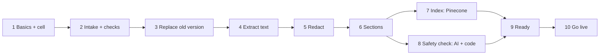

# Workflow spec: Onboarding (v1)

From `docs/templates/WORKFLOW.md`. Status: **draft for review**.

## Demo build (before cells)

For Demo Day, one business, without cells (M2) or background jobs:

- Upload: Markdown, text, CSV, PDF and Word documents, read in the request
  (readers.py); images and scanned pages come later.
- Read as they are (D31): SmartDesk asks the owner nothing about the business.
  What the documents say about services, prices and policies is the owner's
  to decide.
- Clean (safety.py, code): scripts, styles, frames, "javascript:" links and
  invisible characters are removed; the owner is told what was removed.
- Safety check (safety.py): code looks for the usual "ignore your instructions"
  phrases; one model call per part of the document (`safety-check` profile)
  looks for harmful content (hate, sexual, violence, illegal, self-harm) and
  text written to an AI assistant. A finding must quote the document, or it
  is dropped. Any finding blocks going live: the owner sees each one in the
  document's own words, fixes the document and uploads it again.
- Booking facts (booking.py, D35): after the check, the services (lengths and
  prices), the team (days and services) and the opening hours are read, in any
  layout. A document in SmartDesk's layout is read by code, exactly; any other
  layout by one model call (`document-reader` profile), then checked by code:
  a service's length and price must each be its own number in the service's
  passage, a staff member's name and each opening hour must be written in the
  document; what is not backed is left out and reported. A business that
  names no staff books with one "Team" calendar. Kept as `schedule.json`;
  booking reads it (business/store.get_schedule).
- Progress: one plain line says which step is running ("Reading your
  documents", "Checking it's safe for your customers", "Understanding your
  services and team", then "Almost done" if it runs on), then what can be
  booked ("6 services with 3 staff, open 6 days"), "All set" and **Proceed**;
  a flagged upload shows **Proceed** disabled, with "Upload again".
- Basics (step 1): name, type and the **business phone number** are required;
  opening hours are not asked, they are read from the documents (D35).
- Phone by default (D36, D37): Go live sets up the business's own number,
  the one customers already call, through ElevenLabs' API (onboarding/phone.py):
  find the number among those connected to ElevenLabs, a workspace secret, the
  business's own agent (its greeting, the Call ID and Caller number lines, the
  Custom LLM at SMARTDESK_PUBLIC_URL), and the
  number attached to it. If the phone cannot be set up (the number is not
  connected yet, the settings are missing, a step fails), what was made is
  taken down and the **website chat still goes live**; the Done step says why
  the phone is not answered yet. Reset gives the number back to the agent it
  answered for before and deletes the rest.
- Calendars at Go live (go-live B4): the calendar is made again for the
  business now live, so each staff member read from its documents has a
  Google calendar ("SmartDesk · <business> – <staff>", created where missing,
  shared with SMARTDESK_CALENDAR_OWNER) before the first booking; reset forgets
  it too. If Google cannot be reached the chat still goes live and Done says so.
- Go live: the checked document is saved in the business's storage
  (`storage/business/`) and the agent uses it at once; the server refuses to
  go live with an unchecked or flagged document, whatever the page sends.
- Booking works for any layout (D35, above); group classes and packages are
  booked only from a document in SmartDesk's layout.

## 1. Purpose and boundaries *(Developer)*

| | |
|---|---|
| **Job, in one sentence** | Turns a business's basics and documents, checked safe for customers, into searchable sections its assistant answers and books from. |
| **Triggered by** | The owner submitting basics, then each document finishing its upload (documents are processed independently) |
| **Input** | Business basics (form); documents with the owner's authorization |
| **Output** | Sections in the business's Pinecone namespace; a live cell with widget code |
| **Done when** | Go-live succeeds (`docs/workflows/go-live.md`, part B) |
| **Out of scope (v1)** | Call recordings; questions to the owner about the business (D31); classes and packages from documents outside SmartDesk's layout; an Onboarding agent; phone-line setup (see the plan's roadmap) |

### Documents accepted

| Kind | Types | Limit |
|---|---|---|
| Document | PDF, DOCX, MD, TXT, CSV | 50 MB · 500 pages per file |
| Image | JPG, PNG | 10 MB per file |

Up to 30 files per upload. Large files upload in chunks and resume after a
dropped connection. The type is checked from the file's contents, not its name.

### Readers (D14)

| Format | Read with | Notes |
|---|---|---|
| PDF | pdfplumber | text per page; tables kept |
| PDF page with no text (scanned) | Claude, reading the page image | |
| DOCX | python-docx | |
| MD, TXT, CSV | Python standard library | |
| JPG, PNG | Claude, reading the image | menus and price boards are often photos |
| Real file type | filetype (the file's first bytes) | a renamed executable is rejected |

Not used: PyMuPDF (AGPL licence, unsuitable for a hosted service); LangChain
loaders (thin wrappers that lose per-page tables). Docling is benchmarked
against pdfplumber (section 5); the better one is kept.

Readers run in a separate process with time and memory limits: a malicious
file can crash only its own job, never the server.

### Where data lives

Everything below is inside the business's own **cell** (D16), created in
step 1; nothing from onboarding is stored in shared space.

| What | Where |
|---|---|
| Business basics | cell database `business.db`, table `business` |
| Original documents | `data/businesses/<id>/files/<document-id>` |
| Document records | cell database, `documents` (name, fingerprint, authorized by, status) |
| Sections (redacted text, document, page) | cell database, `sections`; embedded into Pinecone namespace `<id>`, each entry tagged with its document id |
| Safety check result | cell database, `documents.check` (findings with their quotes; empty when safe) |

## 2. Steps

| # | Step | Code or AI | Input → output | On failure | Safe to re-run? |
|---|---|---|---|---|---|
| 1 | Basics and cell | code | form → the business's cell, status *draft* (go-live part A) | form shows the error; nothing half-created | yes |
| 2 | Intake and checks | code | chunks → original on disk + `documents` row; real type, size, pages, duplicate fingerprint | reject the file with the reason | yes |
| 3 | Replace | code | same document name uploaded before → its old sections and index entries removed | stop; nothing half-replaced | yes |
| 4 | Extract text | code; Claude for images and scanned pages | document → text per page, tables kept; scripts and invisible characters removed | flag the file as unreadable | yes |
| 5 | Redact | code + small AI | text → personal details replaced | stop: nothing unredacted is stored | yes |
| 6 | Sections | code | text → sections by heading, each with document and page | one section per page | yes |
| 7 | Index | code | sections → embeddings in this business's namespace | retry; earlier sections stay searchable | yes |
| 8 | Safety check | **AI** + code | text → findings (strict schema), each quoting the document; code drops a finding it cannot find | stop: nothing goes live unchecked | yes |
| 9 | Ready | code | safe: "All set" and Go live; flagged: each finding in the document's words, and re-upload | — | — |
| 10 | Go live | code | widget key, phone line (owner's yes), calendar → cell *live* (go-live part B) | all undone; cell stays *draft* with the reason | yes |

### Safety check rules (code, around the AI)

- **Clean first**: what a page could run or a reader cannot see is removed
  before anything is stored or read by a model.
- **Only what must not reach customers**: harmful content and text written to
  an assistant. The business itself is never judged or questioned (D31).
- **Quote or drop**: every finding quotes the document; code looks the quote
  up, so a model's mistake never blocks an owner.
- **Block, never warn**: any finding stops going live; the server refuses,
  whatever the page sends. The owner fixes the document and uploads it again.

### Timing and progress

Steps 2–8 run in the background per document; the owner can leave and come
back. Each document shows its own progress. Rough expectations, to be
replaced by measurements in M5–M6: a few seconds for a short document;
minutes for a 300-page PDF (the safety check runs on parts in parallel).

## 3. AI inside steps *(System prompt + paved roads)*

| Step | Prompt (path) | Allowed output (schema) | Unsure behaviour | Model | Why |
|---|---|---|---|---|---|
| 4 Images, scans | `onboarding/vision.py` | plain text of the page | mark unreadable parts | today's model (D7) | menus and scans have no text layer |
| 5 Redact | `onboarding/redact.py` | text with placeholders | hide when unsure | small model | pattern rules miss names |
| 8 Safety check | `onboarding/safety.py` | `FindingsRead` (strict tool schema): kind and quote | no finding when unsure; ordinary business content is not harmful | today's model (D7) | harm needs reading, not keywords |

Document text is data, never instructions, in every prompt.

## 4. Threats and design review *(AI security review)*

| Threat | Where | Defence | Tested by |
|---|---|---|---|
| Malicious file | steps 2, 4 | real type check; limits; readers in a limited separate process | upload tests |
| Poisoned document | steps 7, 8 | text is data to every model; text written to an assistant is found (code phrases and the check) and blocks going live | poisoned-document test |
| A wrong finding blocks an owner | step 8 | a finding must quote the document, checked by code | quote test |
| Leakage between businesses | all | every row, file path and namespace bound to the business id | isolation test |
| Personal details stored | steps 4–6 | redact before storing sections | seeded-details test |
| Stale data after re-upload | step 3 | old sections and entries removed first | re-upload test |
| Cost runaway | steps 4, 8 | file and page limits; per-business daily budget | limit test |

## 5. Tests that must pass *(Policy gates)*

| Gate | Cases | Bar |
|---|---|---|
| Steps on their own | each step with small fixtures | all pass |
| Parser benchmark | pdfplumber vs Docling on 3–5 documents | better one chosen, scores recorded |
| Safety check | harmful and takeover passages; clean business documents of several kinds | all flagged; **zero flags on clean documents** |
| Re-upload | same document twice, changed price | only the new price searchable and bookable |
| Large input | 300-page PDF | completes; timing recorded |
| Attack inputs | hidden instructions; renamed executable | behaviour unchanged; rejected |
| Isolation and personal details | two businesses; seeded details | zero leaks |

## 6. Release *(Deployment)*

local → staging (the test business, resettable) → production; only versions whose gates passed.

## 7. Live checks *(Runtime verification)*

| | |
|---|---|
| **Status shown to the owner** | each document's progress and any problem; can leave and return |
| **Audit log** | uploads, authorizations, replacements, blocked uploads: who and when |
| **Alerts** | a step failing for many documents; budget reached |
| **Debug view** | per document: each step started · done · failed, with time; sections and safety findings |
| **Reset / re-run** | reset onboarding clears documents, sections and the namespace for one business (owner only, typed confirmation) |
